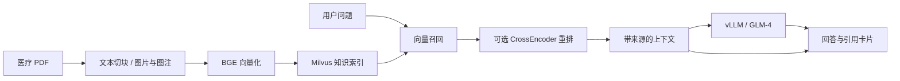

# 智能医疗问答平台

**面向医疗文献的图文 RAG 问答：检索资料、生成回答，并追溯到原始文件、页码与相关图片。**

以糖尿病视网膜病变筛查资料为应用场景，串联 PDF 文本与图片提取、BGE 向量化、Milvus 检索、CrossEncoder 重排、vLLM / GLM-4 生成，以及 FastAPI 查询页面。

**Python · FastAPI · Milvus · BGE Embedding · BGE Reranker · vLLM · GLM-4 · PyMuPDF**

[](https://github.com/liberal123/medical-rag-platform/actions/workflows/checks.yml)

[快速体验](#快速体验) · [三分钟演示](docs/SHOWCASE.md) · [接入真实模型](docs/DEPLOYMENT.md) · [评估说明](docs/EVALUATION.md) · [工程验证](reports/VALIDATION.md)

本地验证：**38 项测试通过，5 道流程示例正常返回，真实 HTTP 问答与引用图片检查通过**。[查看原始记录](reports/VALIDATION.md)。

## 能看到什么

- **答案与证据一起展示：** 引用卡片显示文件名、页码、文本片段、检索/重排分数与可用图片。
- **可控的检索链路：** 可调整初始召回数量、最终引用数量和重排开关，便于检查答案依赖的材料。
- **图文资料处理：** 逐页解析 PDF，按字符窗口切块；图片通过候选图注和所在页面文本参与检索。
- **模型服务解耦：** RAG 应用通过 HTTP 访问 vLLM，应用依赖与 GPU 推理服务分别管理。
- **可追溯评估：** 保存逐题回答、引用、耗时和异常，统计关键词覆盖、来源命中及可选语义相似度。

图片功能用于查找和展示文献中的图片；系统没有眼底图像诊断模型。项目提供资料查询与工程演示，不作患者诊断或治疗决策。

## 系统流程



## 快速体验

Python 3.10+。默认演示模式使用仓库内编写的流程说明样例，进行词面检索并返回原文摘录，无需 GPU 或下载模型。页面和 API 都会标明该模式。

```bash
git clone https://github.com/liberal123/medical-rag-platform.git
cd medical-rag-platform
python -m venv .venv
# Windows PowerShell：.\.venv\Scripts\Activate.ps1
# Linux/macOS：source .venv/bin/activate
python -m pip install -r requirements.txt
python -m pip install -e . --no-deps
python scripts/prepare_demo.py
python -m uvicorn medical_rag.app:app --host 127.0.0.1 --port 9001
```

浏览器打开 [问答页面](http://127.0.0.1:9001/dr/demo) 或 [API 文档](http://127.0.0.1:9001/docs)。选择页面中的示例问题，观察回答、引用资料和流程示意图。

演示模式用于体验证据呈现流程；真实 Milvus、BGE、重排模型与 GLM-4 通过下文配置接入。

## 接入真实模型

在 Linux RAG 应用环境安装 `requirements-live.txt`，准备自己的 PDF 与模型目录，使用已有的 vLLM 服务或按 [部署说明](docs/DEPLOYMENT.md) 启动模型服务。

```bash
python -m medical_rag.ingest --pdf-dir data/pdfs --output-dir data/knowledge --image-dir data/images

python -m medical_rag.build_index \
  --input data/knowledge/chunks.jsonl \
  --input data/knowledge/images.jsonl

export MEDRAG_MODE=live
export MEDRAG_LLM_BASE_URL=http://127.0.0.1:8001/v1
export MEDRAG_LLM_MODEL=glm-4
python -m uvicorn medical_rag.app:app --host 127.0.0.1 --port 9001
```

默认模型名 `BAAI/bge-small-zh-v1.5` 和 `BAAI/bge-reranker-base` 可通过环境变量替换为本地目录。`MEDRAG_LLM_MODEL` 必须与模型服务实际暴露的 ID 一致。首次创建索引会加载 embedding 模型；同名索引已存在时拒绝覆盖。

PDF 的真实文件名与页码保留在记录中。图片向量来自图注和页面上下文文本，未使用视觉 embedding。中文知识补充与 PDF 文本合并属于语料增强，本实现没有 BM25 与 dense 的混合检索。

## 项目结构

```text
src/medical_rag/
  config.py       环境配置与项目路径
  ingest.py       PDF 文本、图片与引用元数据
  build_index.py  Milvus 索引构建
  retrieval.py    向量检索与重排
  llm.py          vLLM 兼容接口客户端
  pipeline.py     问答流程与演示模式
  app.py          FastAPI 接口
  evaluate.py     逐题评估与汇总
web/              问答与引用展示页面
examples/         自编流程说明与示意图
tests/            工程行为测试
docs/             部署、数据和评估说明
reports/          可复核的本地工程验证
```

## API 示例

```http
POST /dr/chat
Content-Type: application/json

{
  "question": "如何根据引用找到原始资料？",
  "retrieval_top_k": 10,
  "final_top_k": 3,
  "use_rerank": true,
  "chunk_chars": 400,
  "max_tokens": 512
}
```

响应包含 `answer`、`references`、`latency_seconds`、运行模式和实际后端信息。模型生成失败返回明确错误；没有检索到证据时，不调用模型编造回答。配置、请求范围和图片路径均在服务端校验。

## 评估与工程验证

```bash
python -m unittest discover -s tests -v
python -m medical_rag.evaluate --input examples/eval_demo.jsonl \
  --output data/eval-runs/demo.jsonl --mode demo
```

指标分别回答“答案包含多少预期关键词”“引用是否包含目标来源”“语义与参考答案是否接近”，不能统称医学准确率。评估输出保留失败样本与分母，包含逐题结果和独立 summary 文件。

本次整理实际执行的测试、API 调用与依赖版本见 [工程验证记录](reports/VALIDATION.md)。既有说明材料中的历史分数及其证据范围见 [评估说明](docs/EVALUATION.md)。

## 资料与许可

仓库不包含模型权重、患者记录、第三方 PDF 或 Milvus 数据库。运行者自行准备有权使用的文献；来源与数据约定见 [数据说明](docs/DATA.md)。

- [Milvus](https://milvus.io/docs)
- [BGE 模型](https://huggingface.co/BAAI)
- [vLLM](https://docs.vllm.ai/)
- [GLM-4](https://github.com/THUDM/GLM-4)
- [PyMuPDF](https://pymupdf.readthedocs.io/)
